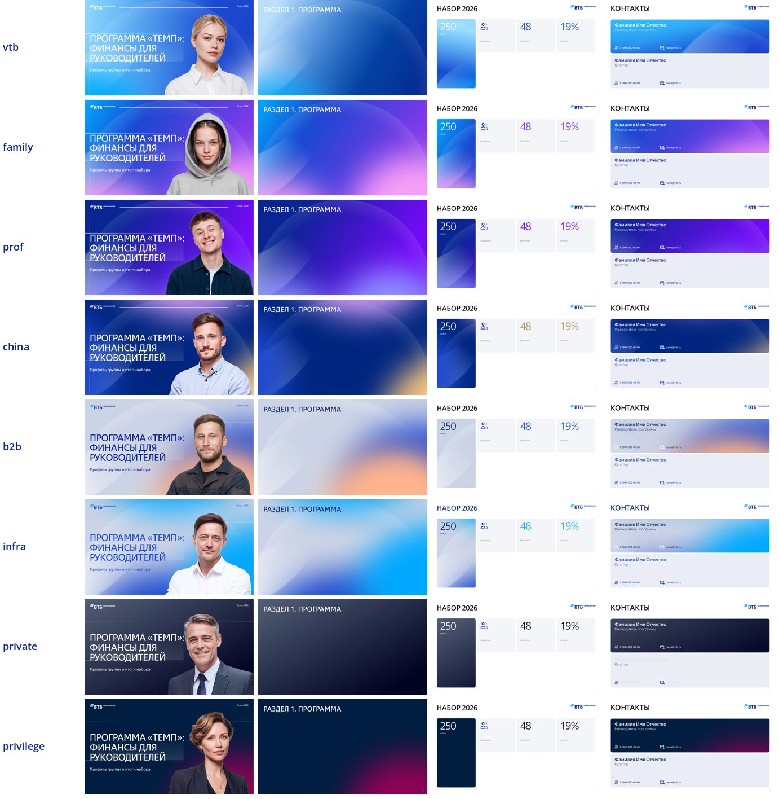
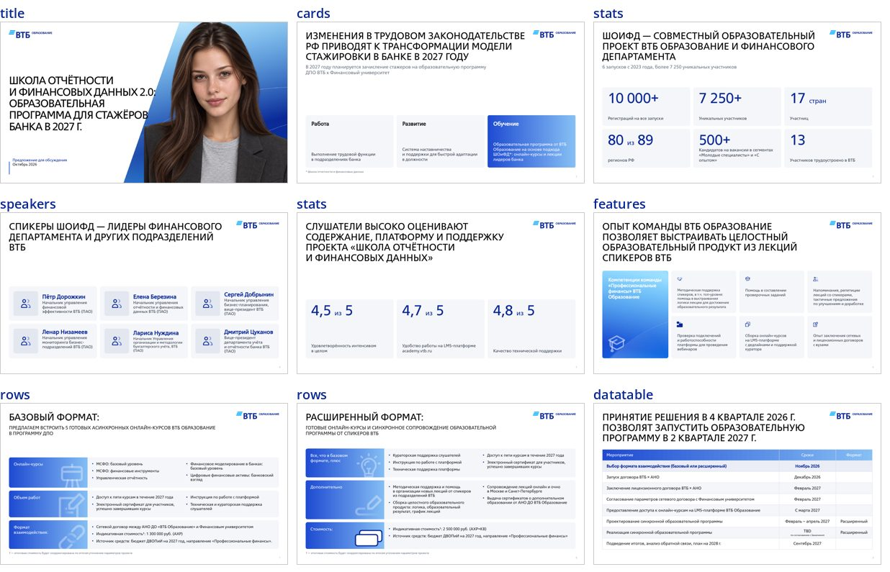
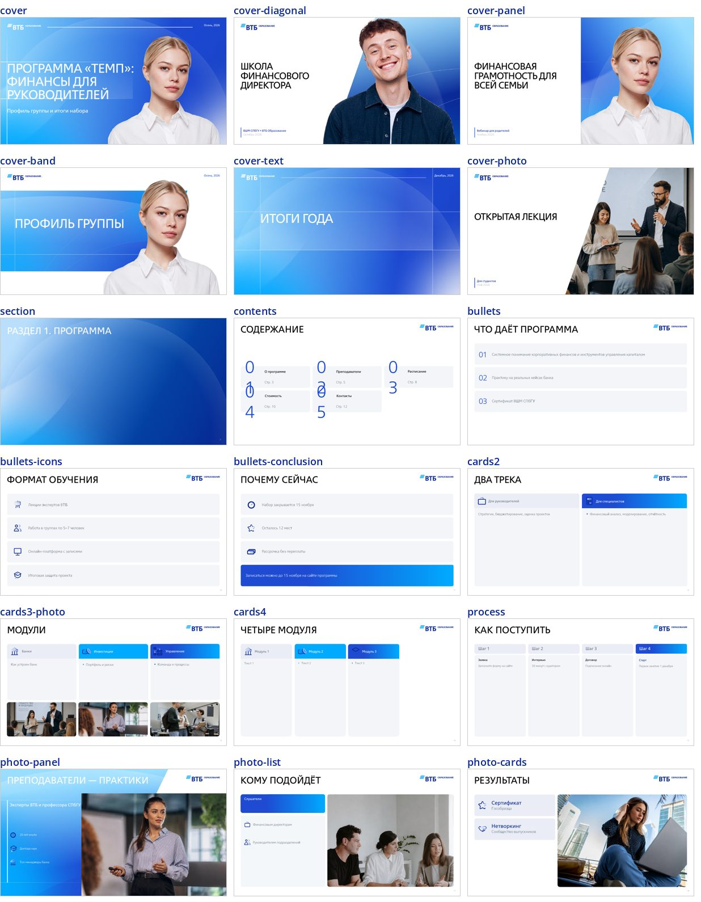
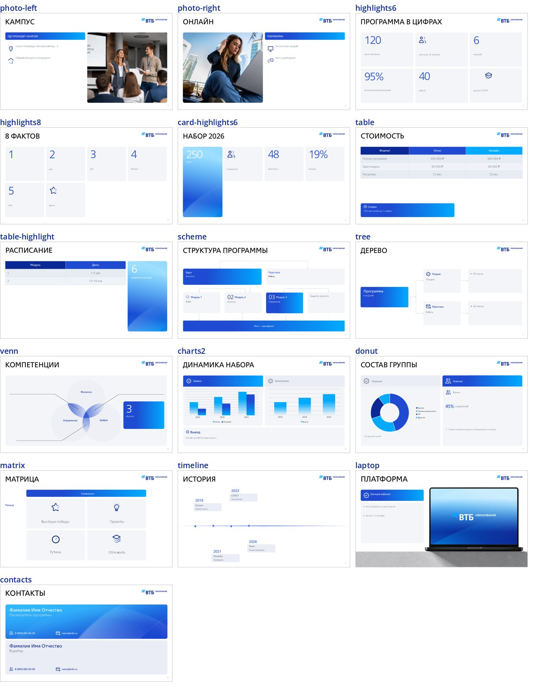

# Скилл презентаций ВТБ Образования

Скилл `vtb-edu-presentations` учит Claude делать презентации PowerPoint по мастер-шаблону «мерико × ВТБ Образование».
На выходе — редактируемый PPTX: тексты, таблицы и диаграммы правятся в PowerPoint.

| 8 | 10 + 38 | 9 | 43 + 114 |
|---|---|---|---|
| направлений бренда | макетов: фирменный стиль + шаблон | портретов для обложек | иконки и иллюстрации |

Содержание: [Установка](#1-установка) · [Как попросить презентацию](#2-как-попросить-презентацию) ·
[Направления](#3-направления) · [Люди на обложке](#4-люди-на-обложке) · [Какие бывают слайды](#5-какие-бывают-слайды) ·
[Что вы получите](#6-что-вы-получите) · [Частые вопросы](#7-частые-вопросы) · [Для разработчиков](#для-разработчиков)

## 1. Установка

Устанавливать нужно один раз.

### claude.ai (браузер, приложение)
1. Скачайте архив **vtb-edu-presentations.zip** со страницы релиза
   [latest](https://github.com/ardubrovskij-dotcom/VTB-edu-brand/releases/tag/latest). Не распаковывайте его.
2. В claude.ai откройте **Настройки → Возможности** (Settings → Capabilities) и включите **выполнение кода и
   создание файлов**. Без этого скилл не сможет собрать PPTX.
3. В том же разделе найдите блок **Скиллы** (Skills), нажмите **Загрузить скилл** и выберите скачанный zip.
4. Проверьте, что скилл **vtb-edu-presentations** появился в списке и включён.

> Если раньше вы загружали старую версию скилла с тем же именем, сначала удалите её, затем загрузите новую.

### Claude Code
1. Подключите репозиторий как источник плагинов:
   ```
   /plugin marketplace add ardubrovskij-dotcom/VTB-edu-brand
   ```
2. Установите плагин:
   ```
   /plugin install vtb-edu-brand@vtb-edu-brand
   ```
   На Claude Code 2.1.275 и новее можно одной командой:
   `/plugin install vtb-edu-brand --marketplace ardubrovskij-dotcom/VTB-edu-brand`
3. Перезапустите Claude Code. Чтобы потом получить новую версию:
   ```
   /plugin marketplace update vtb-edu-brand
   ```
4. Для сборки на компьютере нужны Python-пакеты, для превью слайдов — ещё LibreOffice и poppler (по желанию):
   ```
   pip install python-pptx pillow lxml
   ```

Без плагина: скопировать папку `skills/vtb-edu-presentations` в `~/.claude/skills/` (или в `.claude/skills/` проекта).

## 2. Как попросить презентацию

Специальная команда не нужна: напишите Claude обычным текстом, что нужно. Скилл включится сам, когда в запросе есть
презентация и ВТБ Образование, его курс или направление. Примеры:

- «Сделай презентацию на 10 слайдов о программе «Темп» для руководителей. Факты — в приложенном документе.»
- «Нужна презентация для направления Private Banking: итоги набора, 3 цифры и контакты куратора. На обложке — Виктор.»
- «Собери слайды вебинара по финграмотности для родителей. Направление — семья, обложка с Соней.»
- «Презентация «ВТБ Образование × ВШМ СПбГУ», логотип партнёра прикладываю, обложка с диагональю.»

### Что подготовить заранее
- **Направление** — от него зависят цвета, фоны и портрет на обложке ([таблица ниже](#3-направления)).
  По умолчанию — «ВТБ Образование».
- **Факты и цифры** — документом, таблицей или текстом. Claude не придумывает цифры, имена и контакты: если данных нет,
  на слайде останется заглушка «Фамилия Имя Отчество».
- **Аудиторию и объём** — для кого и сколько минут или слайдов (ориентир — 1 слайд на 1–2 минуты).
- **Логотип партнёра** (PNG), если нужна обложка «ВТБ × партнёр».
- **QR-код** (PNG) для слайда контактов — по желанию.

### Что будет дальше
1. Если чего-то не хватает, Claude задаст вопросы одним сообщением.
2. Для колоды больше 8 слайдов Claude сначала покажет план «слайд — мысль» на согласование.
3. Claude соберёт PPTX и, если среда позволяет, PDF и картинки слайдов для проверки.
4. Вы скачиваете PPTX и правите его в PowerPoint как обычную презентацию. Попросить правку можно и в чате:
   «замени фото на третьем слайде», «сократи текст карточек».

## 3. Направления

Направление можно назвать словами — Claude поймёт. Ключ нужен, только если вы пишете файл колоды сами.

| Направление | Ключ | Палитра | Портрет по умолчанию |
|---|---|---|---|
| ВТБ Образование (основное) | `vtb` | синий, голубой | Алина |
| Финансовая грамотность для всей семьи | `family` | голубой, фиолетовый, розовый | Соня |
| Профессиональные финансы | `prof` | синий, фиолетовый | Артём |
| Китайское направление | `china` | тёмно-синий, лотос, золото | Максим |
| B2B-направление | `b2b` | светлый, персиковый | Денис |
| Крупные инфраструктурные проекты в регионах РФ | `infra` | светлый, голубой | Сергей |
| Private Banking | `private` | графит, медь | Виктор |
| Привилегия | `privilege` | тёмно-синий, бордо | Елена |



## 4. Люди на обложке

Человека можно назвать по имени: «на обложке Артём». Без указания будет портрет направления. Это модели-образы,
а не реальные эксперты: не подписывайте их именами спикеров.


| Аудитория | Кого поставить |
|---|---|
| Студенты, молодые специалисты | Алина, Артём, Дарья |
| Дети и семьи | Соня |
| Руководители, корпоративные клиенты | Максим, Сергей, Елена |
| Производство, регионы, рабочие профессии | Денис |
| Премиальные клиенты | Виктор, Елена |

## 5. Какие бывают слайды

По умолчанию слайды собираются в **фирменном стиле команды** — как в эталонной презентации «ШОиФД 2.0»:
заголовок-вывод прописными, контент прижат к низу, серые карточки, крупные цифры, диагональная обложка
([правила](skills/vtb-edu-presentations/references/house-style.md)).



Макет Claude подбирает сам по содержанию. Можно попросить конкретный: «сделай цифры плитками», «таблицу с выводом»,
«таймлайн».

| Что показать | Макеты |
|---|---|
| Обложка и разделы | 6 обложек (с портретом, с фото, с логотипом партнёра), разделитель |
| Содержание и тезисы | содержание на 9 пунктов, списки до 4 пунктов, список с выводом |
| Параллельные блоки | 2, 3 или 4 карточки, с фото и без; процесс из 4 шагов |
| Ключевые цифры | 6 или 8 плиток, высокая карточка с главной цифрой |
| Текст и атмосфера | 5 макетов «фото + пункты» |
| Сравнение, цены, расписание | таблица с выводом, таблица с карточкой |
| Структура и данные | схема, дерево, пересечение кругов, матрица 2 × 2, гистограммы, кольцевая диаграмма |
| Даты | таймлайн до 7 событий |
| Финал | контакты на 2 человека, с QR-кодом или без |

<details>
<summary>Превью всех макетов</summary>




</details>

## 6. Что вы получите

- **PPTX** — основной файл. Все слайды построены на мастер-шаблоне, тексты живые, таблицы и диаграммы родные
  (данные диаграмм правятся в Excel через PowerPoint).
- **PDF** — для отправки, если среда Claude умеет его делать.

> В файле прописан шрифт **VTB Group**, но сам шрифт не встроен. На компьютере, где VTB Group установлен, презентация
> выглядит как шаблон. Без шрифта PowerPoint подставит замену, и переносы строк могут сдвинуться.

## 7. Частые вопросы

<details>
<summary>Скилл не включился, Claude делает презентацию по-своему</summary>

Явно назовите скилл: «используй скилл vtb-edu-presentations». Проверьте, что скилл включён в настройках,
а в claude.ai — что включено выполнение кода.
</details>

<details>
<summary>Нужен слайд, которого нет в списке</summary>

Claude возьмёт ближайший макет и скажет об этом. Пузырьковую и лепестковую диаграммы, диаграмму Ганта и мокап
телефона скилл не собирает: их лучше доделать в PowerPoint по образцу шаблона.
</details>

<details>
<summary>Текст не помещается в карточку</summary>

Скилл сам уменьшает шрифт, но не ниже читаемого размера. Если текст всё равно не помещается, Claude предложит
сократить его или разбить слайд на два.
</details>

<details>
<summary>Можно своё фото вместо стандартного?</summary>

Да: приложите картинку и скажите, на какой слайд её поставить. Фото обрежется по рамке автоматически. Для обложки
подходит только портрет, вырезанный на прозрачном фоне (PNG).
</details>

<details>
<summary>Маркетинг обновил шаблон — что делать</summary>

Отдать новый PPTX и папку «ВТБ О брендинг» владельцу репозитория. Порядок обновления — в
[`references/assets.md`](skills/vtb-edu-presentations/references/assets.md). После обновления zip в релизе
пересоберётся автоматически, а в Claude Code достаточно команды `/plugin marketplace update vtb-edu-brand`.
</details>

## Для разработчиков

### Сборка без Claude
```bash
pip install python-pptx pillow lxml
python3 skills/vtb-edu-presentations/scripts/build_deck.py skills/vtb-edu-presentations/examples/example.json -o out/ --preview
```
`--preview` дополнительно делает PDF и PNG (нужны LibreOffice и poppler-utils).
Списки ресурсов: `build_deck.py --list-people`, `build_deck.py --list-icons`.

### zip для claude.ai
Собирается автоматически (`.github/workflows/skill-zip.yml`) при каждом изменении в `skills/` и кладётся в релиз
[latest](https://github.com/ardubrovskij-dotcom/VTB-edu-brand/releases/tag/latest). Вручную:
```bash
cd skills && zip -r ../vtb-edu-presentations.zip vtb-edu-presentations -x '*/__pycache__/*'
```

### Структура
```
.claude-plugin/          манифест плагина и маркетплейса, иконка
skills/vtb-edu-presentations/
  SKILL.md               инструкция для Claude
  scripts/               build_deck.py (сборка), layouts.py (макеты, направления, портреты)
  tools/                 prepare_template.py (обновление шаблона)
  assets/                облегчённый шаблон, фоны, карточки, портреты, фото, логотип
  references/            описание макетов, бренда, ресурсов; превью
  examples/              пример колоды и превью
```

### Источник бренда
Папка «ВТБ О брендинг» (Google Drive): шаблон презентации PPTX, «Фоны на слайды», «Карточки для презентации», «Люди».
Что откуда взято и как обновить — [`references/brand.md`](skills/vtb-edu-presentations/references/brand.md),
[`references/assets.md`](skills/vtb-edu-presentations/references/assets.md).
